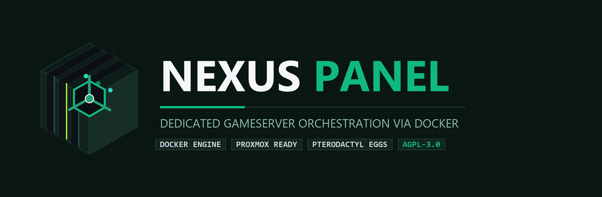

<p align="center">
  
</p>

<p align="center">
  <a href="README.md"><b>🇩🇪 Deutsch</b></a> &nbsp;•&nbsp; <b>🇬🇧 English</b>
</p>

<p align="center">
  <a href="https://github.com/brogameryt/nxpanel/releases"></a>
  
  <a href="https://ko-fi.com/brogameryt" target="_blank"></a>
  <a href="LICENSE"></a>
  =22-5B9DF5?style=for-the-badge&logo=node.js&logoColor=white" alt="Node.js">
  
</p>

---

> [!CAUTION]
> ### ⚠️ Important Notice: Project in Active Development (Alpha / Work in Progress)
> **NexusPanel is currently in an early alpha development stage!**
> - Features and interfaces may change at any time, and you may encounter **bugs, crashes, or potential data loss**.
> - **Please do not deploy on production live servers without external backups!**
> - We strongly recommend testing in isolated virtual machines, containers, or dedicated lab environments.
> - Bugs, suggestions, and feedback are always welcome under [GitHub Issues](https://github.com/brogameryt/nxpanel/issues).

---

## ⚡ Quick Access

| Area | Description | Link |
|---|---|---|
| 📦 **Downloads & Releases** | Latest versions, packages, and release assets | [👉 To Releases (Right Sidebar)](https://github.com/brogameryt/nxpanel/releases) |
| 📜 **Changelog** | Complete history of all releases and changes | [CHANGELOG.md](CHANGELOG.md) |
| 📋 **Roadmap & Tasks** | Open tasks, milestones, and criteria for v1.0 | [docs/TODO.md](docs/TODO.md) |
| 📐 **Architecture** | Technical structure, host layer & NexusCore | [docs/ARCHITEKTUR.md](docs/ARCHITEKTUR.md) |
| 🎮 **Egg Catalog** | 263 analyzed game templates & 25 built-in eggs | [docs/EGG-KATALOG.md](docs/EGG-KATALOG.md) |
| 🧪 **Test Reports** | Automated installation and startup test results | [docs/GAME-INSTALL-TESTS.md](docs/GAME-INSTALL-TESTS.md) |
| 🌍 **Localization** | Supported languages & guide to contribute | [#localization](#-languages--translations-localization) |
| ☕ **Support Project** | Support development and server hardware | [👉 Ko-fi / brogameryt](https://ko-fi.com/brogameryt) |

---

## 🌟 About NexusPanel

NexusPanel is a modern, lightweight game server management platform built on OCI Docker containers. Inspired by Pterodactyl and AMP, it combines high performance with full control, a modern user interface, and native integrations for popular game servers.

### Core Features
- 🎮 **Diverse Game Servers**: Out-of-the-box support for Minecraft (Java & Bedrock), ARK: Survival Ascended, Palworld, Rust, Valheim, Counter-Strike 2, Satisfactory, 7 Days to Die, Sons of the Forest, TeamSpeak, and many more.
- 📦 **Modpack Integration**: Direct search and 1-click updates for CurseForge, Modrinth, and FTB modpacks.
- ⏱️ **Automated Schedules**: Minute-accurate background scheduler for automatic restarts, backups, and console commands.
- 🛡️ **Role-Based Access Control (RBAC)**: Roles (`admin`, `moderator`, `user`), customizable co-user permissions (Viewer, Operator, Manager, Co-Admin), and server assignments.
- 💾 **Streaming Backups**: Highly compressed `tar.zst` (Zstandard) archives with SHA-256 checksums, automated integrity checks, and native NAS mirroring (SMB/CIFS).
- 📜 **File Manager with Revision History**: Integrated source code editor with line numbers, syntax highlighting, revision history (up to 25 versions/file), and formatted markdown preview.
- 📖 **Documentation Library**: Full documentation browser directly in the web interface with live search and table of contents.

---

## 🚀 Installation & Quickstart

### 1. Linux Server or VM (Recommended)

Requirements: Debian 12 (Bookworm) or Ubuntu 22.04+, Docker Engine 26+.

```bash
# Clone the repository
git clone https://github.com/brogameryt/nxpanel.git /opt/nxpanel
cd /opt/nxpanel

# Prepare environment configuration
cp .env.example .env
nano .env  # Configure passwords, JWT_SECRET, and ENCRYPTION_KEY!

# Start services via Docker Compose
docker compose -f deploy/docker-compose.yml up -d
```

The panel is now accessible at `http://<YOUR-SERVER-IP>:8080`.

### 2. Automated Installation via Script

```bash
sudo bash install/install-linux.sh
```

### 3. Proxmox VE (VM or LXC)

```bash
# Run on your Proxmox host:
bash install/proxmox-vm.sh  # Creates a Debian 12 VM
# or
bash install/proxmox-ct.sh  # Creates an unprivileged LXC container
```

### 4. Windows 10/11 (Development & Testing)

Run PowerShell as Administrator:

```powershell
Set-ExecutionPolicy -Scope Process Bypass
.\install\install-windows.ps1
```

*Note: Requires Docker Desktop with an active WSL2 backend.*

---

## 🛠️ Development & Manual Build

```bash
# Install dependencies
npm install
npm --prefix web install

# Start development server with live reload
npm run dev

# Build production artifacts
npm run build
npm --prefix web run build
```

---

## 🔒 Security & Disclosure

- **Vulnerability Reports:** Please do **not** disclose security vulnerabilities publicly in GitHub Issues. See [SECURITY.md](SECURITY.md) for our coordinated vulnerability disclosure policy.
- **Docker Socket:** The panel service communicates with the host's Docker socket. For security reasons, always run NexusPanel inside a dedicated virtual machine (VM) or an isolated server instance.

---

## 🌍 Languages & Translations (Localization)

NexusPanel is designed with native multi-language support from the ground up. The web UI automatically selects the user's browser language, or users can switch languages manually in the panel.

### Current Language Status

| Language | Code | Status | File |
|---|:---:|:---:|---|
| 🇩🇪 **Deutsch** | `de` | ✅ **100%** (Native / Complete) | [`web/src/locales/de.json`](web/src/locales/de.json) |
| 🇬🇧 **English** | `en` | ✅ **100%** (Reference Language) | [`web/src/locales/en.json`](web/src/locales/en.json) |
| 🇫🇷 **Français** | `fr` | ⏳ Looking for contributors | `web/src/locales/fr.json` |
| 🇪🇸 **Español** | `es` | ⏳ Looking for contributors | `web/src/locales/es.json` |
| 🇵🇱 **Polski** | `pl` | ⏳ Looking for contributors | `web/src/locales/pl.json` |
| 🇮🇹 **Italiano** | `it` | ⏳ Looking for contributors | `web/src/locales/it.json` |
| 🌍 **Other Languages** | `...` | 💡 Welcomed anytime! | – |

### 🤝 How to Contribute a Translation

Would you like to translate NexusPanel into your native language or help refine existing texts? **Contributions are warmly welcomed!**

1. **Use the reference template:**
   Start by opening the English reference file:
   👉 **[`web/src/locales/en.json`](web/src/locales/en.json)** *(or alternatively [`web/src/locales/de.json`](web/src/locales/de.json))*.
2. **Copy & Translate:**
   Copy the file and name it after your ISO language code (e.g., `fr.json`, `es.json`, `tr.json`). Translate only the **values** on the right — keep all keys and placeholders like `{name}`, `{count}`, or `{file}` intact.
3. **Submit:**
   - **Via Pull Request:** Submit your new `.json` file inside `web/src/locales/`.
   - **Or via GitHub Issue:** Open a [GitHub Issue](https://github.com/brogameryt/nxpanel/issues) and attach your translated JSON file!

*Detailed localization documentation:* 📖 **[`web/src/locales/README.md`](web/src/locales/README.md)**

---

## ☕ Support & Donations

If you enjoy NexusPanel and want to support ongoing development, game template maintenance, and test server hardware, any support on **Ko-fi** is greatly appreciated!

<p align="center">
  <a href="https://ko-fi.com/brogameryt" target="_blank">
    
  </a>
</p>

👉 **[Support on Ko-fi (ko-fi.com/brogameryt)](https://ko-fi.com/brogameryt)**

---

## 🤖 Development & AI Transparency

NexusPanel is architected, developed, and tested on dedicated bare-metal and Proxmox hardware by **[BroGamerYT](https://github.com/brogameryt)**.

> [!NOTE]
> **Transparency:** Development is conducted in agile pair-programming with modern AI assistants — primarily **Claude** and **Google Antigravity**. Technical vision, software architecture, live system validation on production Linux hosts, and manual code craft remain firmly in human hands.

---

## 📄 License

This project is licensed under the **[GNU Affero General Public License v3.0 (AGPL-3.0)](LICENSE)**. If you modify NexusPanel or run it as a network service, you must release your modifications under the same license.
