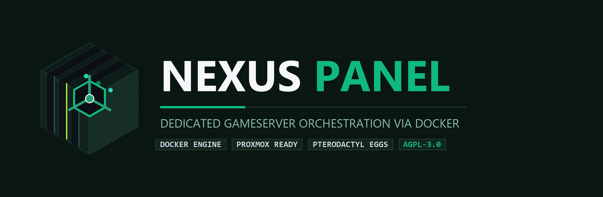

<p align="center">
  
</p>

<p align="center">
  <b>🇩🇪 Deutsch</b> &nbsp;•&nbsp; <a href="README.en.md"><b>🇬🇧 English</b></a>
</p>

<p align="center">
  <a href="https://github.com/brogameryt/nxpanel/releases"></a>
  
  <a href="https://ko-fi.com/brogameryt" target="_blank"></a>
  <a href="LICENSE"></a>
  =22-5B9DF5?style=for-the-badge&logo=node.js&logoColor=white" alt="Node.js">
  
</p>

---

> [!CAUTION]
> ### ⚠️ Wichtiger Hinweis: Projekt in aktiver Entwicklung (Alpha / Work in Progress)
> **NexusPanel befindet sich derzeit in einer frühen Alpha-Phase!**
> - Funktionen können sich jederzeit ändern, und es kann zu **Fehlern, Abstürzen oder Datenverlust** kommen.
> - **Bitte noch nicht auf produktiven Live-Servern ohne externe Backups einsetzen!**
> - Wir empfehlen das Testen in isolierten VMs, Containern oder Testumgebungen.
> - Fehler, Ideen und Feedback können gerne unter [Issues](https://github.com/brogameryt/nxpanel/issues) gemeldet werden.

---

## ⚡ Schnellzugriff

| Bereich | Beschreibung | Link |
|---|---|---|
| 📦 **Downloads & Releases** | Neueste Versionen, Pakete und Release-Assets | [👉 Zu den Releases (Rechte Leiste)](https://github.com/brogameryt/nxpanel/releases) |
| 📜 **Changelog** | Vollständige Historie aller Versionen und Änderungen | [CHANGELOG.md](CHANGELOG.md) |
| 📋 **Roadmap & Geplant** | Offene Aufgaben, Meilensteine und Kriterien für 1.0 | [docs/TODO.md](docs/TODO.md) |
| 📐 **Architektur** | Technischer Aufbau, Host-Schicht & NexusCore | [docs/ARCHITEKTUR.md](docs/ARCHITEKTUR.md) |
| 🎮 **Egg-Katalog** | 263 analysierte Spielvorlagen & 25 integrierte Eggs | [docs/EGG-KATALOG.md](docs/EGG-KATALOG.md) |
| 🧪 **Testberichte** | Automatisierte Installations- und Start-Tests | [docs/GAME-INSTALL-TESTS.md](docs/GAME-INSTALL-TESTS.md) |
| 🌍 **Übersetzungen** | Sprachen & Anleitung zum Mitübersetzen | [#sprachstatus](#-sprachen--übersetzung-localization) |
| ☕ **Projekt unterstützen** | Unterstütze die Entwicklung & Serverkosten | [👉 Ko-fi / brogameryt](https://ko-fi.com/brogameryt) |

---

## 🌟 Über NexusPanel

NexusPanel ist eine moderne, leichtgewichtige Gameserver-Verwaltungsplattform auf Basis von OCI-Docker-Containern. Inspiriert von Pterodactyl und AMP, kombiniert es maximale Leistung mit voller Kontrolle, moderner Benutzeroberfläche und nativer Integration für gängige Spieleserver.

### Kern-Features
- 🎮 **Vielfältige Spieleserver**: Direkte Unterstützung für Minecraft (Java & Bedrock), ARK: Survival Ascended, Palworld, Rust, Valheim, Counter-Strike 2, Satisfactory, 7 Days to Die, Sons of the Forest, TeamSpeak und viele mehr.
- 📦 **Modpack-Integration**: Direkte Suche und 1-Klick-Updates für CurseForge-, Modrinth- und FTB-Modpacks.
- ⏱️ **Automatisierte Zeitpläne**: Minütlicher Hintergrund-Scheduler für automatische Neustarts, Backups und Server-Kommandos.
- 🛡️ **Rechteverwaltung (RBAC)**: Rollen (`admin`, `moderator`, `user`), anpassbare Mitnutzer-Rechte (Zuschauer, Operator, Verwalter, Co-Admin) und Server-Zuweisungen.
- 💾 **Streaming Backups**: Hochkomprimierte `tar.zst` (Zstandard) Archive mit SHA-256 Prüfsummen, Validitätsprüfung und automatischer NAS-Spiegelung (SMB/CIFS).
- 📜 **Dateimanager mit Historie**: Integrierter Quelltext-Editor mit Zeilennummern, Syntax-Highlighting, Revisions-Historie (bis zu 25 Versionen/Datei) und formatierter Markdown-Vorschau.
- 📖 **Dokumentations-Bibliothek**: Vollständiger Dokumentations-Viewer direkt im Webinterface mit Live-Suche und Inhaltsverzeichnis.

---

## 🚀 Installation & Schnellstart

### 1. Linux-Server oder VM (Empfohlen)

Voraussetzungen: Debian 12 (Bookworm) oder Ubuntu 22.04+, Docker Engine 26+.

```bash
# Repository klonen
git clone https://github.com/brogameryt/nxpanel.git /opt/nxpanel
cd /opt/nxpanel

# Konfiguration vorbereiten
cp .env.example .env
nano .env  # Passwörter und JWT_SECRET / ENCRYPTION_KEY anpassen!

# Dienste über Docker Compose starten
docker compose -f deploy/docker-compose.yml up -d
```

Das Panel ist anschließend unter `http://<DEINE-SERVER-IP>:8080` erreichbar.

### 2. Automatische Installation via Skript

```bash
sudo bash install/install-linux.sh
```

### 3. Proxmox VE (VM oder LXC)

```bash
# Auf dem Proxmox-Host ausführen:
bash install/proxmox-vm.sh  # Erstellt eine Debian-12-VM
# oder
bash install/proxmox-ct.sh  # Erstellt einen unprivilegierten LXC-Container
```

### 4. Windows 10/11 (Entwicklung & Test)

PowerShell als Administrator ausführen:

```powershell
Set-ExecutionPolicy -Scope Process Bypass
.\install\install-windows.ps1
```

*Hinweis: Benötigt Docker Desktop mit aktivem WSL2-Backend.*

---

## 🛠️ Entwicklung & Manueller Build

```bash
# Abhängigkeiten installieren
npm install
npm --prefix web install

# Entwicklungsserver starten
npm run dev

# Produktion bauen
npm run build
npm --prefix web run build
```

---

## 🔒 Sicherheit & Vertraulichkeit

- **Sicherheitsmeldungen:** Bitte Sicherheitslücken **nicht** öffentlich in den Issues posten. Siehe [SECURITY.md](SECURITY.md) für den Meldekontakt.
- **Docker-Socket:** Der Panel-Dienst steuert die Docker Engine des Hosts. Aus Sicherheitsgründen sollte NexusPanel immer in einer dedizierten virtuellen Maschine (VM) oder einem isolierten Server betrieben werden.

---

## 🌍 Sprachen & Übersetzung (Localization)

NexusPanel ist von Grund auf mehrsprachig aufgebaut. Die Weboberfläche passt sich automatisch der Browsersprache an oder kann vom Nutzer direkt im Panel flexibel umgestellt werden.

### Sprachstatus

| Sprache | Code | Status | Übersetzungsdatei |
|---|:---:|:---:|---|
| 🇩🇪 **Deutsch** | `de` | ✅ **100%** (Native / Vollständig) | [`web/src/locales/de.json`](web/src/locales/de.json) |
| 🇬🇧 **English** | `en` | ✅ **100%** (Referenzsprache) | [`web/src/locales/en.json`](web/src/locales/en.json) |
| 🇫🇷 **Français** | `fr` | ⏳ Suche Übersetzer | `web/src/locales/fr.json` |
| 🇪🇸 **Español** | `es` | ⏳ Suche Übersetzer | `web/src/locales/es.json` |
| 🇵🇱 **Polski** | `pl` | ⏳ Suche Übersetzer | `web/src/locales/pl.json` |
| 🇮🇹 **Italiano** | `it` | ⏳ Suche Übersetzer | `web/src/locales/it.json` |
| 🌍 **Weitere Sprachen** | `...` | 💡 Jederzeit willkommen! | – |

### 🤝 Bei Übersetzungen mitmachen (So geht's!)

Möchtest du NexusPanel in deine Muttersprache übersetzen oder bestehende Übersetzungen verfeinern? **Jeder Beitrag ist herzlich willkommen!**

1. **Beispiel-/Referenzdatei öffnen:**
   Nimm als Vorlage die englische Referenzdatei:
   👉 **[`web/src/locales/en.json`](web/src/locales/en.json)** *(oder alternativ [`web/src/locales/de.json`](web/src/locales/de.json))*.
2. **Kopieren & Übersetzen:**
   Kopiere die Datei und benenne sie nach dem ISO-Sprachcode (z.&nbsp;B. `fr.json`, `es.json`, `tr.json`). Übersetze darin nur die **Werte** – die Schlüssel links sowie Variablen wie `{name}`, `{count}` oder `{file}` bleiben unverändert.
3. **Einreichen:**
   - **Per Pull Request:** Reiche die neue `.json`-Datei im Ordner `web/src/locales/` ein.
   - **Oder per GitHub Issue:** Erstelle ein [GitHub Issue](https://github.com/brogameryt/nxpanel/issues) und hänge deine übersetzte JSON-Datei einfach an!

*Ausführliche Dokumentation zur Lokalisierung:* 📖 **[`web/src/locales/README.md`](web/src/locales/README.md)**

---

## ☕ Unterstützung & Spenden

Wenn dir NexusPanel gefällt und du die Weiterentwicklung, Test-Server und Hardware unterstützen möchtest, freue ich mich riesig über deine Unterstützung auf **Ko-fi**! Jeder Beitrag hilft direkt bei der Realisierung neuer Funktionen und der Wartung von Vorlagen.

<p align="center">
  <a href="https://ko-fi.com/brogameryt" target="_blank">
    
  </a>
</p>

👉 **[Hier auf Ko-fi unterstützen (ko-fi.com/brogameryt)](https://ko-fi.com/brogameryt)**

---

## 🤖 Entwicklung & KI-Transparenz (Entwicklungsprozess)

NexusPanel wird von **[BroGamerYT](https://github.com/brogameryt)** konzipiert, programmiert und auf dedizierter Bare-Metal- und Proxmox-Hardware auf Herz und Nieren getestet.

> [!NOTE]
> **Transparenz:** Die Entwicklung erfolgt im agilen Pair-Programming mit moderner KI-Unterstützung – maßgeblich durch **Claude** und **Google Antigravity**. Die technische Vision, Architektur, praktische Erprobung im Live-Betrieb auf echten Linux-Systemen und manueller Code-Feinschliff liegen dabei stets in eigener Hand.

---

## 📄 Lizenz

Dieses Projekt steht unter der **[GNU Affero General Public License v3.0 (AGPL-3.0)](LICENSE)**. Wer NexusPanel modifiziert oder als Online-Dienst anbietet, muss den Quellcode seiner Änderungen offenlegen.
